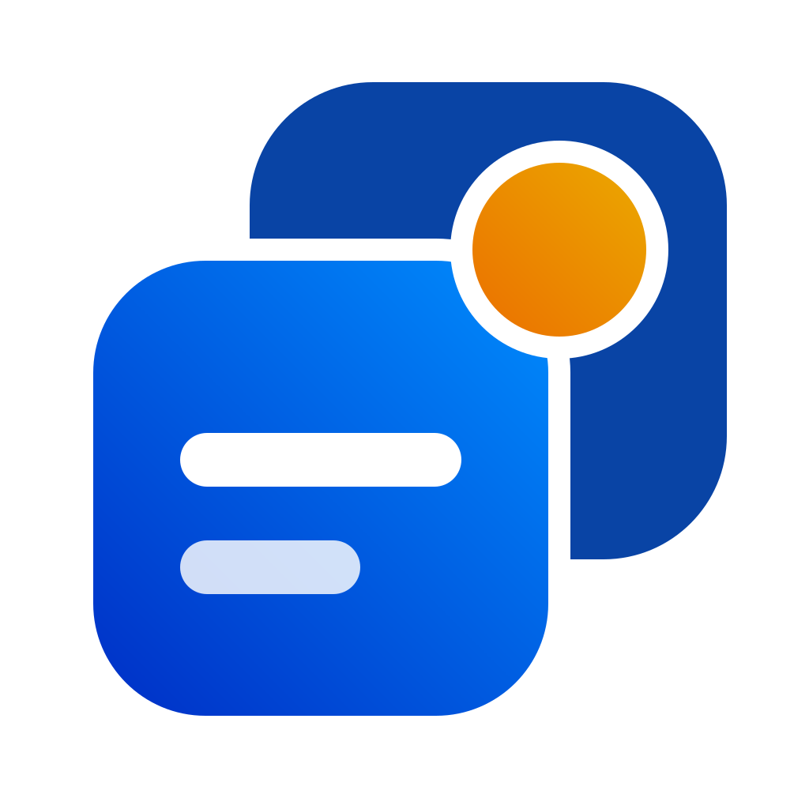
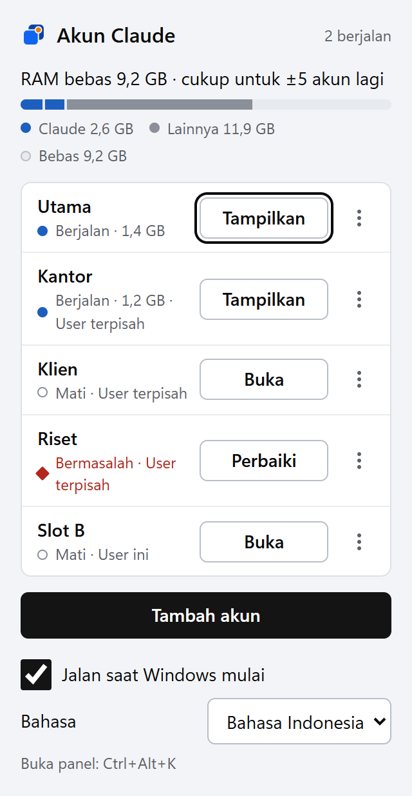
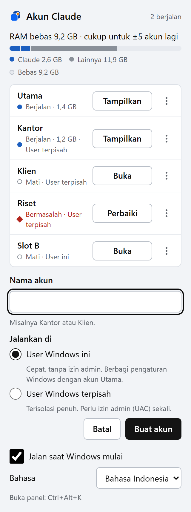

# Claude Switcher

**Jalankan beberapa akun Claude Desktop sekaligus di Windows, langsung dari tray.**

_Alat tidak resmi dan open source dari [Coding Folks](https://codingfolks.dev). Tidak berafiliasi dengan Anthropic._

[Unduh](https://github.com/Coding-Folks/claude-switcher/releases/latest) · [Cara kerja](docs/HOW-IT-WORKS.md) · [Mengatasi masalah](docs/TROUBLESHOOTING.md) · [English](README.md)

---

Claude Desktop hanya bisa login ke satu akun dalam satu waktu. Kalau Anda punya akun pribadi dan akun
kantor, atau menangani beberapa klien, Anda harus bolak-balik logout dan login. **Claude Switcher**
membuat semua akun terbuka bersamaan, masing-masing di jendelanya sendiri, sementara skills, plugins,
dan memory tetap dipakai bersama.

  
  &nbsp;&nbsp;
  

## Fitur

- **Banyak akun sekaligus.** Jumlahnya hanya dibatasi RAM. Panel menampilkan pemakaian setiap akun
  dan perkiraan berapa akun lagi yang muat.
- **Dua cara menjalankan akun** (dipilih per akun):

  | | **User Windows ini** (default) | **User Windows terpisah** |
  |---|---|---|
  | Persetujuan admin (UAC) | Tidak perlu | Sekali, saat akun ditambahkan |
  | Isolasi | Folder data Claude sendiri | User Windows tersembunyi sendiri |
  | Skills, plugins, memory | Dipakai bersama (user yang sama) | Dipakai bersama lewat junction |
  | Cocok untuk | Kebanyakan orang | Pemisahan yang ketat |

- **Impor riwayat:** menyalin daftar sesi Claude Code ke akun baru dengan sekali klik.
- **Perbaiki:** satu tombol untuk login yang ditolak, sambungan yang rusak, atau folder yang terhapus.
- **Ramah keyboard dan pembaca layar:** `Ctrl+Alt+K` membuka panel dari mana saja. Mengikuti
  WCAG 2.2 AA, diuji dengan axe dan Narrator.
- **Tema terang dan gelap** mengikuti Windows, serta mendukung mode kontras tinggi.
- **Bahasa Indonesia dan English**, mengikuti bahasa Windows atau pilihan Anda sendiri.

## Instalasi

1. Pasang **Claude Desktop** untuk Windows dari [claude.ai/download](https://claude.ai/download).
2. Unduh installer `…_x64-setup.exe` dari
   [rilis terbaru](https://github.com/Coding-Folks/claude-switcher/releases/latest), lalu jalankan.
   Aplikasi terpasang untuk semua user di `Program Files` (satu kali persetujuan admin).
3. Buka **Claude Switcher** dari Start Menu. Ikonnya muncul di tray.

> **Muncul peringatan SmartScreen?** Tanda tangan kode lewat SignPath Foundation sedang disiapkan.
> Sampai aktif, installer belum ditandatangani, jadi Windows mungkin menyebut penerbitnya tidak
> dikenal. Pilih **More info → Run anyway**, atau build sendiri dari kode sumber. Setiap rilis
> mencantumkan SHA-256 installer, dan mulai 0.2.0 juga atestasi build GitHub. Lihat
> [cara memeriksa unduhan](docs/CODE-SIGNING.md#checking-a-download).

**Kebutuhan:** Windows 10 atau 11 (x64) dan Claude Desktop versi Microsoft Store / MSIX.

## Cara pakai

| Untuk | Lakukan |
|---|---|
| Membuka panel | Klik ikon tray, atau tekan **Ctrl+Alt+K** |
| Menambah akun | **Tambah akun** → beri nama → pilih **Jalankan di** → **Buat akun**, lalu login di jendela Claude yang terbuka |
| Membuka atau menampilkan akun | **Buka** / **Tampilkan** di baris akun |
| Menutup satu akun | **⋯ → Tutup** |
| Menyalin sesi Code ke akun itu | **⋯ → Impor riwayat** (login ke akun itu dulu) |
| Mengatasi masalah | Tombol **Perbaiki** muncul di baris yang bermasalah |
| Menghapus akun | **⋯ → Hapus** (login dan datanya ikut terhapus; akun Utama aman) |
| Mengganti bahasa | **Bahasa** di bagian bawah panel |

## Cara kerja singkat

- **User Windows ini:** setiap akun punya folder di `%LOCALAPPDATA%\ClaudeSwitcher\slots\<id>` yang
  disiapkan supaya Claude Desktop memakainya sebagai folder data sendiri. Tanpa hak admin dan tanpa
  user Windows tambahan.
- **User Windows terpisah:** aplikasi membuat user Windows tersembunyi untuk setiap akun (satu kali UAC),
  menyimpan password acaknya hanya di Windows Credential Manager, dan menyambungkan `~/.claude`
  user itu ke milik Anda.

Penjelasan lengkap: [docs/HOW-IT-WORKS.md](docs/HOW-IT-WORKS.md).

## Keamanan dan privasi

- Password user tersembunyi dibuat acak (32 karakter), hanya disimpan di **Windows Credential Manager**,
  dan tidak pernah ditulis ke disk maupun log.
- Proses admin hanya menerima empat operasi tetap untuk nama user berawalan `claude-`, dan hanya
  membaca atau menulis file di folder pertukarannya sendiri.
- Tidak ada data yang dikirim ke mana pun: tidak ada telemetri dan tidak ada permintaan jaringan.

Menemukan celah keamanan? Lihat [SECURITY.md](SECURITY.md). Cara rilis dibangun dan ditandatangani:
[docs/CODE-SIGNING.md](docs/CODE-SIGNING.md).

## Lisensi dan merek dagang

[MIT](LICENSE) © 2026 Coding Folks.

Claude Switcher adalah proyek independen yang **tidak berafiliasi dengan, tidak didukung, dan tidak
disponsori oleh Anthropic**. "Claude" dan "Claude Desktop" adalah merek dagang Anthropic, PBC, dan
dipakai di sini hanya untuk menjelaskan aplikasi yang didukung alat ini. Logo Claude Switcher adalah
karya orisinal Coding Folks.
