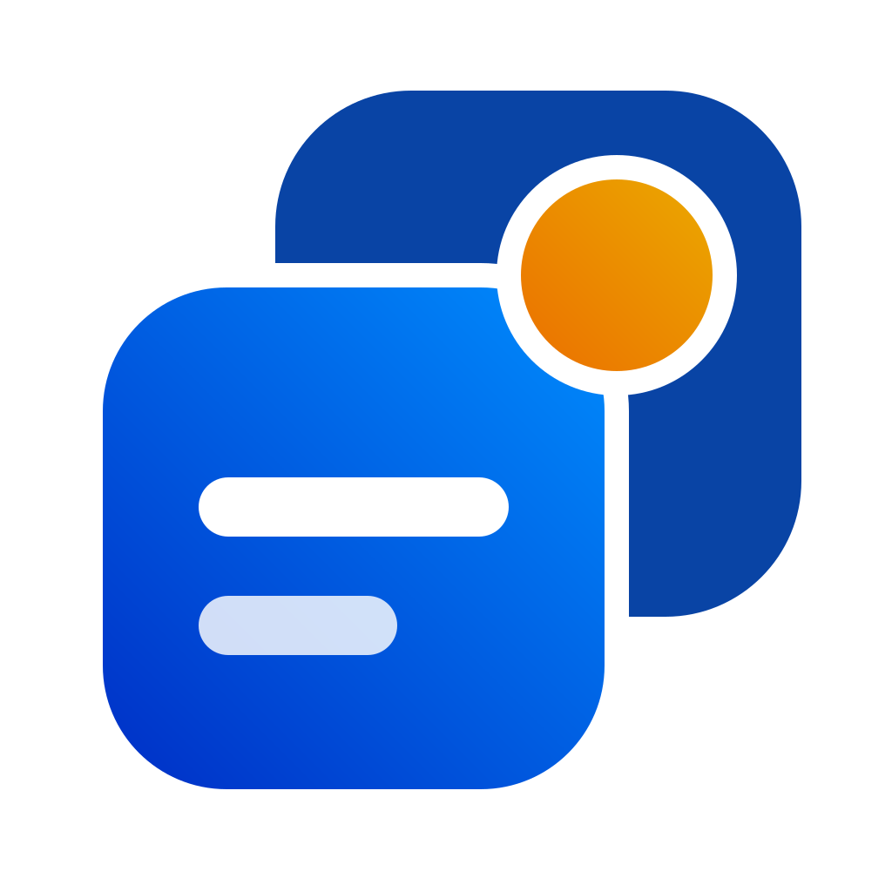
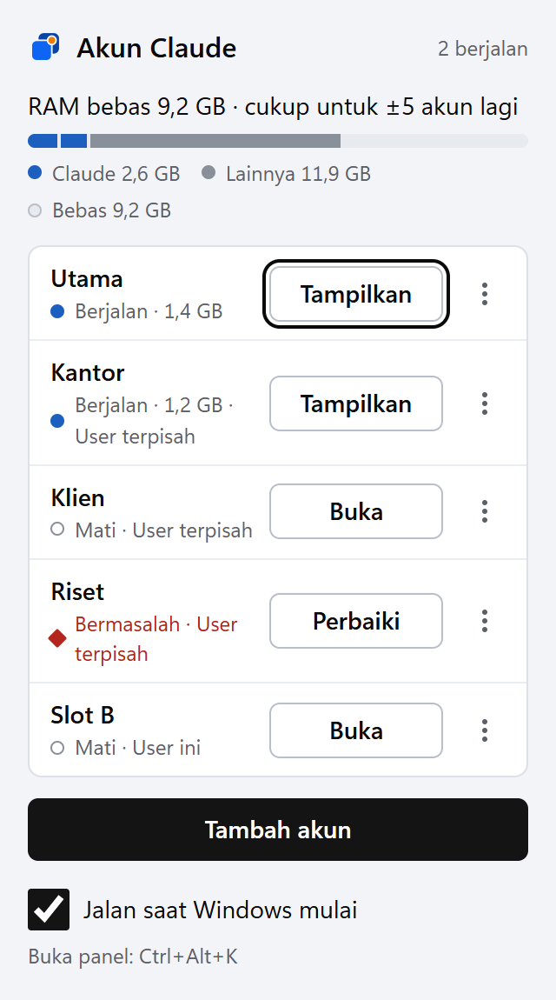
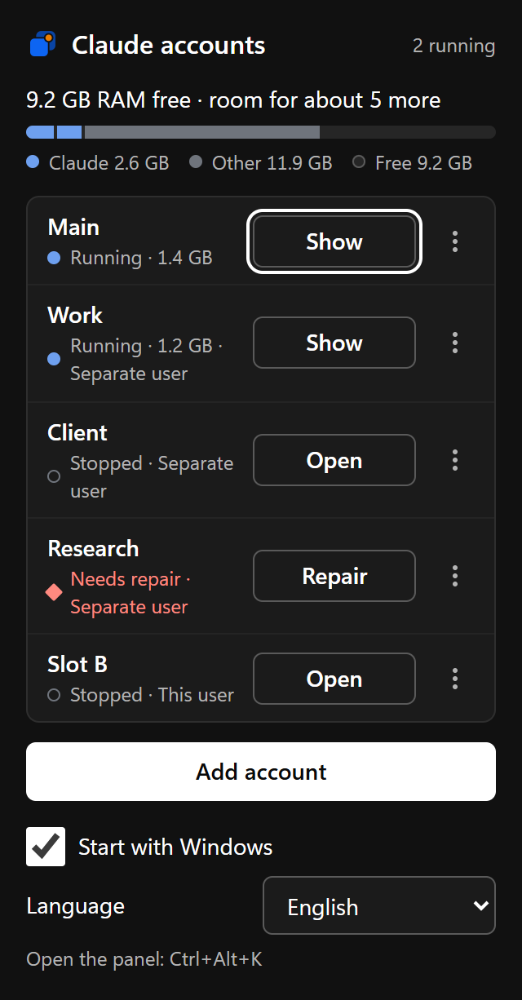

<div align="center">



# Claude Switcher

**Run several Claude Desktop accounts side by side on Windows — from the tray.**

_An unofficial, open-source tool by [Coding Folks](https://codingfolks.dev). Not affiliated with Anthropic._

[](https://github.com/Coding-Folks/claude-switcher/actions/workflows/ci.yml)
[](https://github.com/Coding-Folks/claude-switcher/releases/latest)


[](LICENSE)

[Download](https://github.com/Coding-Folks/claude-switcher/releases/latest) · [How it works](docs/HOW-IT-WORKS.md) · [Troubleshooting](docs/TROUBLESHOOTING.md) · [Bahasa Indonesia](README.id.md)

</div>

---

Claude Desktop lets you sign in to one account at a time. If you use a personal account and a work
account, or help several clients, you sign out and in again all day. **Claude Switcher** keeps every
account open at once, each in its own window, while your skills, plugins and memory stay shared.

<p align="center">
  
  &nbsp;&nbsp;
  
</p>

## Features

- **Many accounts at once.** Open as many Claude Desktop accounts as your RAM allows; the panel shows
  how much each one uses and how many more fit.
- **Two ways to run an account** (choose per account):

  | | **This Windows user** (default) | **A separate Windows user** |
  |---|---|---|
  | Admin prompt (UAC) | None | Once, when you add it |
  | Isolation | Own Claude data folder | Own hidden Windows user |
  | Skills, plugins, memory | Shared (same user) | Shared through a folder junction |
  | Best for | Most people | Strict separation |

- **Import history.** Bring your Claude Code session list into a new account in one click.
- **Repair.** One button fixes a refused sign-in, a broken link or a recreated folder.
- **Keyboard and screen-reader friendly.** `Ctrl+Alt+K` opens the panel from anywhere; it follows
  WCAG 2.2 AA and is tested with axe and Narrator.
- **Light and dark** to match Windows, and high-contrast mode support.

## Install

1. Install **Claude Desktop** for Windows from [claude.ai/download](https://claude.ai/download).
2. Download `Claude Switcher_x.y.z_x64-setup.exe` from the
   [latest release](https://github.com/Coding-Folks/claude-switcher/releases/latest) and run it.
   It installs for all users into `Program Files` (one admin prompt).
3. Start **Claude Switcher** from the Start menu. Its icon appears in the tray.

> **SmartScreen warning?** The installer is not code-signed yet, so Windows may say it is from an
> unknown publisher. Choose **More info → Run anyway**, or build it yourself (below). Each release
> lists the SHA-256 of the installer so you can check it.

**Requirements:** Windows 10 or 11 (x64) and Claude Desktop (the Microsoft Store / MSIX build).

## Use

| To | Do |
|---|---|
| Open the panel | Click the tray icon, or press **Ctrl+Alt+K** |
| Add an account | **Tambah akun** → name it → choose where it runs → **Buat akun**, then sign in in the new Claude window |
| Open or show an account | **Buka** / **Tampilkan** on its row |
| Close one account | **⋯ → Tutup** |
| Copy your Code sessions into it | **⋯ → Impor riwayat** (sign in to that account first) |
| Fix a problem | **Perbaiki** appears on the row when something is wrong |
| Remove an account | **⋯ → Hapus** (its login and data go; your main account is untouched) |

The interface is in Bahasa Indonesia today. All text lives in [`ui/strings.js`](ui/strings.js) —
translations are very welcome.

## How it works, in short

- **This Windows user:** each account gets a folder under
  `%LOCALAPPDATA%\ClaudeSwitcher\slots\<id>`, prepared so Claude Desktop uses it as its own data
  folder. No admin rights, no extra Windows users.
- **A separate Windows user:** the app creates a hidden local Windows user per account (one UAC
  prompt), keeps its random password only in Windows Credential Manager, and links that user's
  `~/.claude` to yours so skills, plugins and memory are shared.

Details, folder layout and the findings behind both modes: [docs/HOW-IT-WORKS.md](docs/HOW-IT-WORKS.md).

## Security and privacy

- Passwords of hidden Windows users are random (32 characters), stored only in **Windows Credential
  Manager**, never written to disk or logs.
- The admin helper accepts just four fixed operations on names that match `claude-*`, and only reads
  or writes files in its own exchange folder.
- Nothing is sent anywhere: the app has no telemetry and makes no network requests of its own.

Found a vulnerability? Please see [SECURITY.md](SECURITY.md).

## Limitations

- Windows only, and only the MSIX build of Claude Desktop.
- Accounts on **this Windows user** share Windows-level settings with your main account (for example
  the `claude://` sign-in link and "Open with"). If a Claude update changes how it picks its data
  folder, the app marks those accounts *Bermasalah* and suggests the separate-user mode.
- "Launch at login" inside Claude itself only knows your main account; use Claude Switcher's own
  **Jalan saat Windows mulai** instead.

## Build from source

You need Rust (stable, MSVC), the Visual Studio C++ build tools with a Windows SDK, Node.js 22 and
Microsoft Edge (for the UI tests).

```bash
cargo install tauri-cli --version "^2" --locked
cd src-tauri && cargo tauri build      # installer in src-tauri/target/release/bundle/nsis/
```

Tests: `cargo test --lib` in `src-tauri` and `npx playwright test` in `tests-ui`. See
[CONTRIBUTING.md](CONTRIBUTING.md) for the full setup, including a Git Bash pitfall.

## Contributing

Bug reports, translations and pull requests are welcome — start with [CONTRIBUTING.md](CONTRIBUTING.md)
and our [Code of Conduct](CODE_OF_CONDUCT.md).

## License and trademarks

[MIT](LICENSE) © 2026 Coding Folks.

Claude Switcher is an independent project. It is **not affiliated with, endorsed by or sponsored by
Anthropic**. "Claude" and "Claude Desktop" are trademarks of Anthropic, PBC, used here only to
describe what this tool works with. The Claude Switcher logo is original artwork by Coding Folks.

<div align="center"><sub>Build things that matter. Ship them with care. — <a href="https://codingfolks.dev">Coding Folks</a></sub></div>
